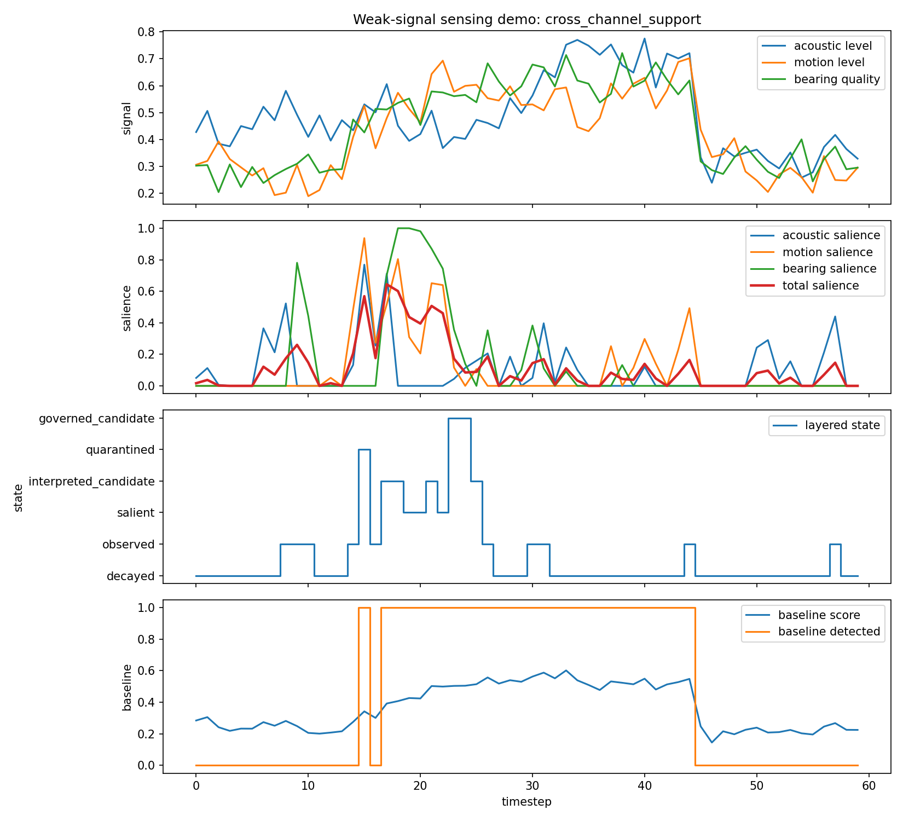
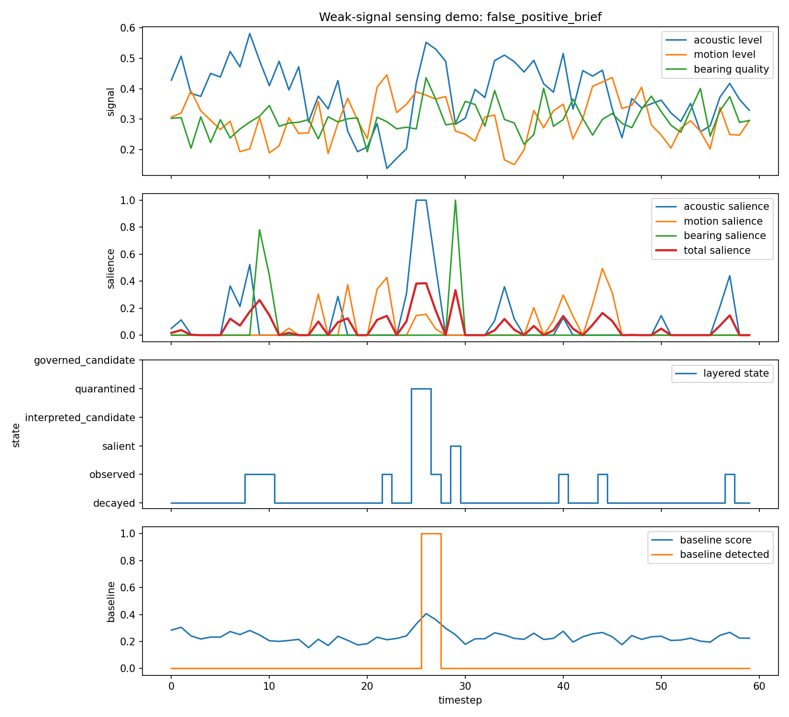

# Weak-Signal Sensing Demo

This repository is a small, deterministic toy demo that simulates a layered weak-signal sensing architecture for low-altitude small-drone style anomaly detection using only synthetic data.

It exists to illustrate behavior for a paper:

- weak cues can be noticed without being overpromoted
- transient clutter can decay cleanly
- persistence plus cross-channel support can justify promotion
- explicit state transitions behave differently from a flat detector

This is intentionally not a real-world system.

## Related Paper and Architecture Context

This demo accompanies **PaperBridge01 — _Weak-Signal Interpretation for Low-Altitude Drone Detection: Toward a Stratified, Deviation-Governed Sensing Architecture_**.

- Zenodo: https://zenodo.org/records/19522384
- Paper PDF in the Spanda Architectural Framework repository: https://github.com/putmanmodel/spanda-architectural-framework/blob/main/papers/bridges/PaperBridge01_Weak-Signal_Interpretation_for_Low-Altitude_Drone_Detection_v0.2.pdf
- Spanda Architectural Framework repository: https://github.com/putmanmodel/spanda-architectural-framework

This repository is a simulation-oriented proof-of-behavior companion to that bridge paper and sits within the broader Spanda architectural stack.

## Non-goals

- Not a real drone detector
- Not trained on real drone data
- Not an operational defense system
- Not an interception, pursuit, or tactics tool

## Pipeline

The demo implements this sequence:

`Sensor Partials -> Reflex Salience -> Deviation Evaluation -> Candidate State -> Governed Promotion`

### 1. Sensor Partials

Each timestep produces local, bounded findings from three synthetic channels:

- acoustic periodicity
- acoustic SNR delta
- motion persistence
- bearing consistency
- bearing variance

These remain uncertainty-bearing local findings. This layer does not declare a target.

### 2. Reflex Salience

This layer compares local findings against a short rolling baseline. It creates temporary attention for recent anomalies but does not create durable candidate state by itself.

### 3. Deviation Evaluation

This layer looks for structure across a short history:

- persistence across windows
- supporting channels
- bearing variance
- repeated salience hits

### 4. Candidate State

The state machine uses explicit deterministic states:

- `observed`
- `salient`
- `interpreted_candidate`
- `governed_candidate`
- `decayed`
- `quarantined`

### 5. Governed Promotion

By default, promotion from `interpreted_candidate` to `governed_candidate` only occurs when:

- persistence is at least 3 windows
- supporting channels are at least 2
- bearing variance is below the configured threshold

If those conditions are not met, the pattern remains provisional, decays, or is quarantined.

## Scenarios

- `clutter_only`: no coherent target, just noise and clutter
- `weak_anomaly_fades`: weak anomaly appears and then dissolves
- `weak_anomaly_persists`: weak anomaly persists long enough to build structure
- `cross_channel_support`: multiple weak channels align over time
- `false_positive_brief`: short strong spike that should not earn durable promotion
- `distributed_nodes`: two weak synthetic nodes combine into stronger central evidence

## Baseline Comparison

The repo also includes a flat score baseline detector that collapses the channel partials into one thresholded score. It is included as a behavioral comparison, not as a strawman.

The expected contrast is:

- the layered pipeline can remain ambiguous instead of making an early binary claim
- brief clutter or short spikes can be quarantined or decay
- persistent multi-channel structure can be promoted more cleanly

The baseline is not guaranteed to be worse in every scenario.

## Setup

Use Python 3.10+.

```bash
python3 -m venv .venv
source .venv/bin/activate
pip install -r requirements.txt
```

## Running

Run a scenario from the CLI:

```bash
python run_demo.py --scenario clutter_only
python run_demo.py --scenario cross_channel_support
python run_demo.py --scenario distributed_nodes
```

Useful flags:

- `--seed 7` for deterministic replay
- `--no-plot` to skip PNG generation
- `--quiet` to suppress per-step console logs
- `--output-dir outputs` to choose where plots and JSON logs go

## Outputs

Each run writes:

- a console trace showing partials, salience, deviation metrics, state, baseline, and transitions
- `outputs/<scenario>.json` with per-step structured data
- `outputs/<scenario>_summary.json` with a short summary
- `outputs/<scenario>.png` with traces, salience, state timeline, and baseline comparison

## Example Outputs

These example plots show how the layered pipeline behaves differently from the flat baseline in two representative scenarios.

### Cross-channel support

Weak multi-channel evidence accumulates over time, the layered architecture progresses through provisional states, and governed promotion occurs only after persistence and support criteria are met. The flat baseline remains more trigger-prone over a longer span.



### Brief false positive

A short anomaly spike raises salience, but the layered system does not overpromote it. The event is contained provisionally rather than treated as a durable candidate, while the flat baseline still fires.



## Repo Layout

```text
README.md
requirements.txt
run_demo.py
src/weak_signal_demo/
outputs/
```

## How To Read A Run

The most important signals to watch are:

- local channel partials: what each channel noticed
- salience: what stands out relative to the recent past
- deviation metrics: whether a pattern is getting structural support
- state transitions: whether evidence is still provisional, decaying, quarantined, or promoted

If a candidate is promoted, the console log prints the explicit reason so a reader can see that promotion came from governed criteria rather than a single large score.

## Relation To A Weak-Signal Sensing Paper

This demo is meant to support a conceptual argument: a layered architecture can preserve weak, uncertain, partial evidence long enough to evaluate whether it becomes meaningful over time. It is a proof-of-behavior illustration only, using synthetic time series and transparent rules instead of a trained model or real sensor stack.

## License

This repository is licensed under the Creative Commons Attribution-NonCommercial 4.0 International license. See `LICENSE` for the repository notice and the linked official legal code.

## Contact

**Stephen A. Putman**  
putmanmodel@pm.me
